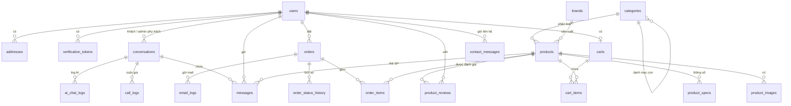

# Database SecureShop

Database đang dùng: **`secureshop_ai`** trên **MariaDB 10.4 của XAMPP** (user `root`, không mật khẩu).

> ⚠️ Trong phpMyAdmin còn database **`secureshop`** (dự án cũ, 12 bảng). Hai database bị gộp chung dưới một nút "secureshop" trong cây bên trái. **Dữ liệu của dự án này nằm ở `secureshop_ai`.**

## Các file SQL

Thư mục `backend/src/main/resources/db/migration/`, import **theo đúng thứ tự** (phpMyAdmin → chọn `secureshop_ai` → tab **Import**):

| File | Nội dung |
|---|---|
| `V1__init_schema.sql` | 19 bảng, khóa ngoại, index, CHECK |
| `V2__seed_data.sql` | Dữ liệu mẫu: 4 tài khoản, 7 danh mục, 11 thương hiệu, 35 sản phẩm + 152 thông số, 6 đơn hàng, 2 hội thoại, log AI, log email |
| `V3__contact_messages.sql` | Bảng `contact_messages` cho form Liên hệ |
| `V4__chat_media.sql` | Chat: thêm loại tin AUDIO/VIDEO, cột `file_size`, `mime_type` |
| `V5__chat_history_view.sql` | View `chat_history` để xem lịch sử chat dễ đọc |
| `V6__favorites.sql` | Bảng `favorites`: sản phẩm yêu thích của khách (mỗi khách thích 1 sản phẩm tối đa 1 lần) |
| `V7__vouchers.sql` | Bảng `vouchers` (mã giảm giá) + cột `orders.voucher_id`, `orders.voucher_code`; 3 mã mẫu |

Flyway đang **tắt** (`spring.flyway.enabled=false`, phiên bản Flyway mới không hỗ trợ MariaDB 10.4), nên các file trên phải tự import. Hibernate chỉ kiểm tra entity có khớp bảng không (`ddl-auto: validate`).

`database/00_create_database.sql` chỉ dùng khi cài trên MySQL 8 riêng (tạo user `secureshop`). Với XAMPP thì bỏ qua: tạo database `secureshop_ai` (collation `utf8mb4_unicode_ci`) trong phpMyAdmin là đủ.

## Tài khoản mẫu

| Email | Mật khẩu | Vai trò |
|---|---|---|
| admin@secureshop.vn | Admin@123 | ADMIN |
| tuvan@secureshop.vn | Admin@123 | ADMIN |
| khachhang1@example.com | Customer@123 | CUSTOMER |
| khachhang2@example.com | Customer@123 | CUSTOMER |

## Dữ liệu chat giữa khách và admin

### Lưu ở đâu

| Nơi lưu | Chứa gì |
|---|---|
| Bảng **`conversations`** | Mỗi khách hàng có 1 cuộc trò chuyện: khách nào (`customer_id`), admin đang phụ trách (`admin_id`), trạng thái, số tin chưa đọc của mỗi bên, thời điểm tin cuối |
| Bảng **`messages`** | Từng tin nhắn: thuộc hội thoại nào, ai gửi (`sender_type`, `sender_id`), loại tin (`type`), nội dung, sản phẩm đính kèm (`product_id`), file đính kèm (`file_url`, `file_name`, `file_size`, `mime_type`), lúc gửi (`created_at`), lúc bên kia xem (`seen_at`) |
| Thư mục **`backend/uploads/chat/`** | File thật của ảnh, ghi âm, video, tài liệu. Database chỉ lưu đường dẫn (`file_url = /api/files/chat/<32 ký tự ngẫu nhiên>.<đuôi>`) |
| View **`chat_history`** | Không lưu gì thêm, chỉ ghép sẵn 2 bảng trên với tên khách, tên người gửi, tên sản phẩm cho dễ đọc |

Các loại tin (`messages.type`): `TEXT` (chữ + emoji), `IMAGE`, `AUDIO` (ghi âm hoặc file âm thanh), `VIDEO`, `FILE` (PDF, Word, Excel), `PRODUCT_CARD` (thẻ sản phẩm), `CALL_LOG` (nhật ký cuộc gọi video).

Người gửi (`messages.sender_type`): `CUSTOMER`, `ADMIN`, `AI`, `SYSTEM` (vd. "đã kết thúc cuộc trò chuyện").

Trạng thái hội thoại (`conversations.status`): `AI → WAITING` (chờ tư vấn viên) `→ ACTIVE` (admin đã trả lời) `→ CLOSED`. Khách nhắn lại thì hội thoại tự mở lại về `WAITING`.

### Một tin nhắn được lưu như thế nào

```
Trình duyệt ──POST /api/chat/conversations/{id}/messages──► ChatService.send()
   (file thì POST /api/chat/upload trước)                      1. INSERT INTO messages ...
                                                               2. UPDATE conversations SET last_message_at, unread_..., status
                                                               3. COMMIT
                                                               4. Đẩy tin qua WebSocket cho bên kia (chỉ sau khi đã lưu xong)
```

Vì tin được lưu **trước** khi gửi đi, tải lại trang hay đăng nhập máy khác vẫn thấy đủ lịch sử.

### Xem trong phpMyAdmin

1. Cây bên trái → **`secureshop_ai`** (không phải `secureshop`).
2. Bấm **`chat_history`** (loại *View*) → tab **Browse** để xem toàn bộ tin nhắn.
3. Hoặc vào tab **SQL** và chạy các câu dưới đây.

Lưu ý: cột "Rows" của phpMyAdmin là số **ước lượng** (vd. hiện ~14 trong khi có 26 tin). Muốn số chính xác thì dùng `COUNT(*)`.

```sql
-- Toàn bộ cuộc trò chuyện của khách hàng có hội thoại số 1
SELECT ma_tin, nguoi_gui, loai_tin, noi_dung, san_pham_dinh_kem, ten_file, gui_luc, da_xem_luc
FROM chat_history WHERE ma_hoi_thoai = 1;

-- Danh sách hội thoại: khách nào, bao nhiêu tin, admin còn bao nhiêu tin chưa đọc
SELECT c.id, u.full_name AS khach_hang, c.status, c.unread_admin, COUNT(m.id) AS so_tin, c.last_message_at
FROM conversations c
JOIN users u ON u.id = c.customer_id
LEFT JOIN messages m ON m.conversation_id = c.id
GROUP BY c.id ORDER BY c.last_message_at DESC;

-- Các file đã gửi trong chat (ảnh, ghi âm, video, tài liệu)
SELECT ma_tin, khach_hang, nguoi_gui, loai_tin, ten_file, dung_luong_byte, duong_dan_file
FROM chat_history WHERE duong_dan_file IS NOT NULL;

-- Đếm số tin theo loại
SELECT type, COUNT(*) FROM messages GROUP BY type;
```

## Sơ đồ quan hệ (ERD)



## Ghi chú thiết kế

- **Trạng thái dạng VARCHAR + CHECK**: khớp `@Enumerated(EnumType.STRING)`, ví dụ `orders.status`: `PENDING → CONFIRMED → SHIPPING → COMPLETED` hoặc `CANCELLED`.
- **`order_items` chép tên, SKU, giá** tại thời điểm mua: sửa hoặc xóa sản phẩm không làm sai đơn cũ và email đã gửi.
- **`orders.receiver_email`**: địa chỉ nhận email xác nhận, có thể khác email tài khoản.
- **`email_logs`**: mỗi email đã gửi (`SENT`/`FAILED` + lỗi), dùng để làm nút "Gửi lại" trong trang admin.
- **`product_specs` dạng key-value**: lọc bằng SQL (`spec_key = 'resolution_mp' AND spec_value >= 4`) và để AI tra cứu thông số thật.
- **`ai_chat_logs`**: lưu intent, độ tin cậy, entities (JSON) mà model dự đoán. Câu bị khách đánh giá `BAD` sẽ được admin gán `corrected_intent`, sau đó xuất ra làm dữ liệu train model phiên bản sau.
- **`messages.file_url`** chỉ nhận đường dẫn file do chính server cấp khi upload (kiểm tra bằng biểu thức chính quy), không nhận link ngoài.
- **`messages.created_at`** là `DATETIME(3)` (chính xác đến mili giây) để sắp xếp đúng các tin gửi sát nhau.
- Đơn hàng mẫu dùng `NOW() - INTERVAL n DAY`, nên dashboard luôn có số liệu của 10 ngày gần nhất.
